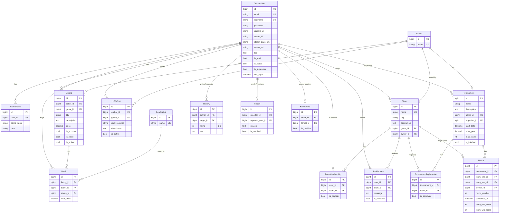

# GamerLair - ER diagram

Every table also has `created_at`, `updated_at` and `deleted_at`
(inherited from `abstracts.AbstractBaseModel`). They are hidden below
to keep the diagram readable.

## Apps and tables

| App               | Tables                                        |
|-------------------|-----------------------------------------------|
| `users`           | CustomUser, GameRank                          |
| `marketplace`     | Game, Listing, DealStatus, Deal               |
| `teams`           | Team, TeamMembership, JoinRequest, LFGPost    |
| `tournaments`     | Tournament, TournamentRegistration, Match     |
| `reviews_ratings` | Review, Report, KarmaVote                     |

## Unique constraints

- `GameRank`: (user, game_name)
- `Deal`: (listing, buyer)
- `TeamMembership`: (user, team)
- `JoinRequest`: (user, team)
- `TournamentRegistration`: (tournament, team)
- `Review`: (author, target)
- `KarmaVote`: (voter, target)
